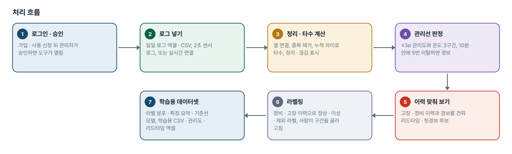
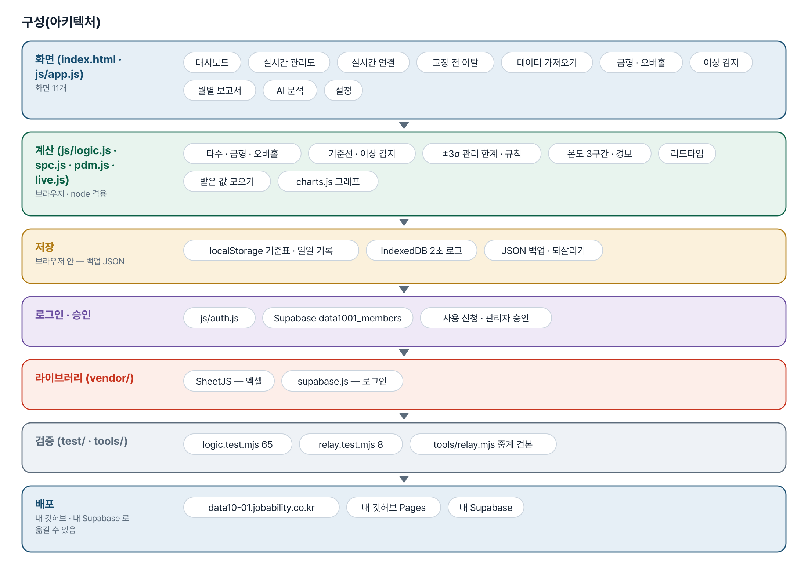
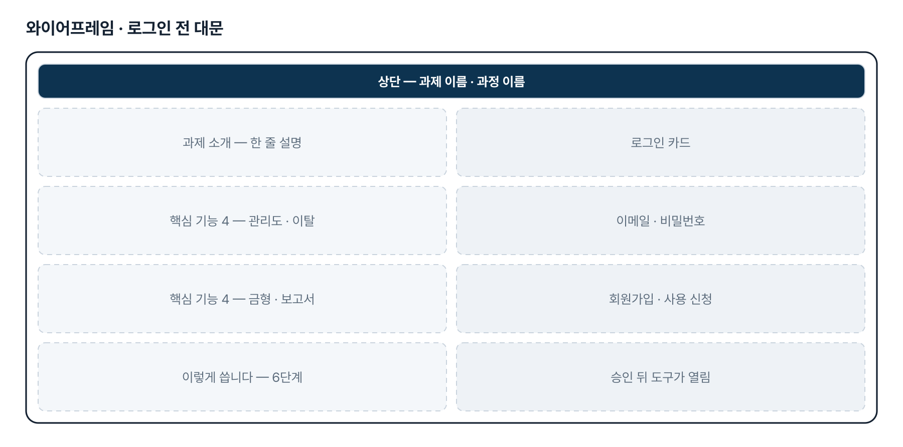
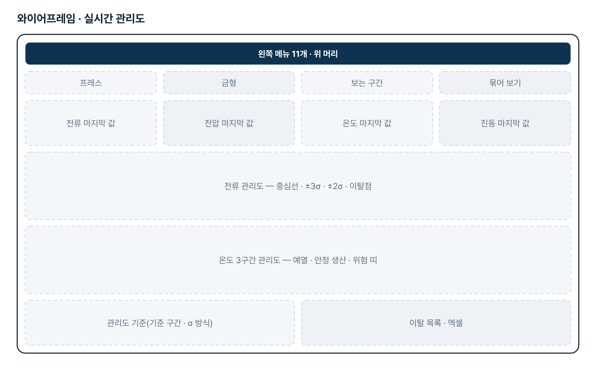
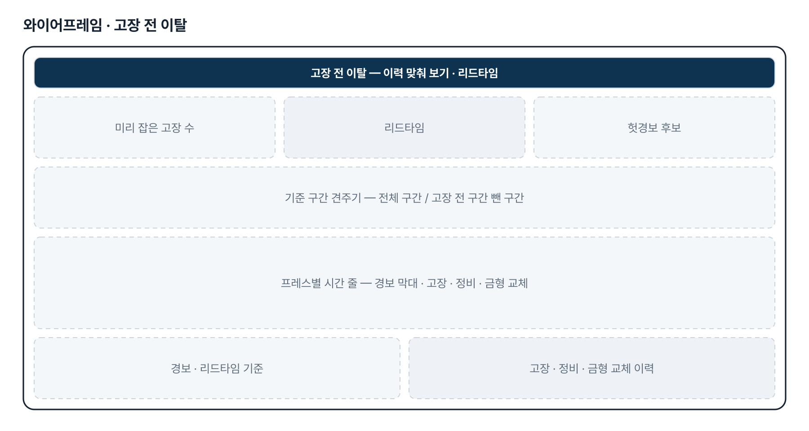
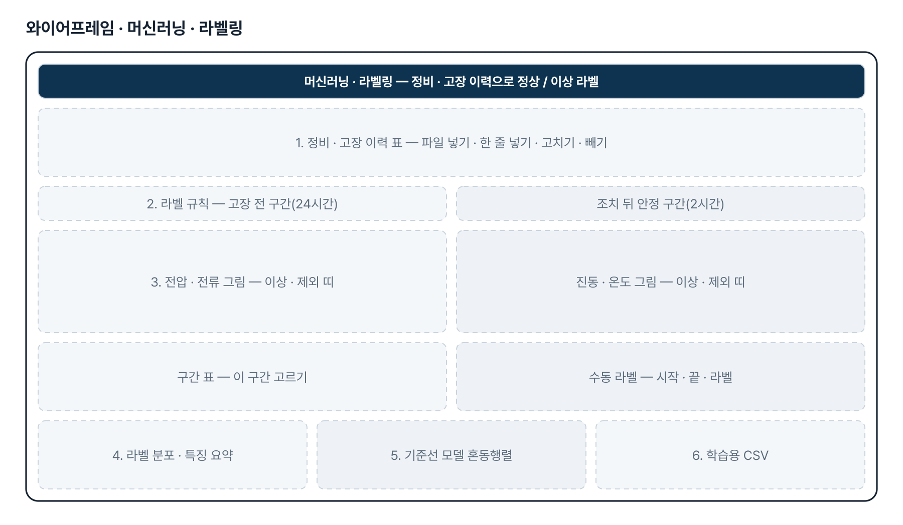
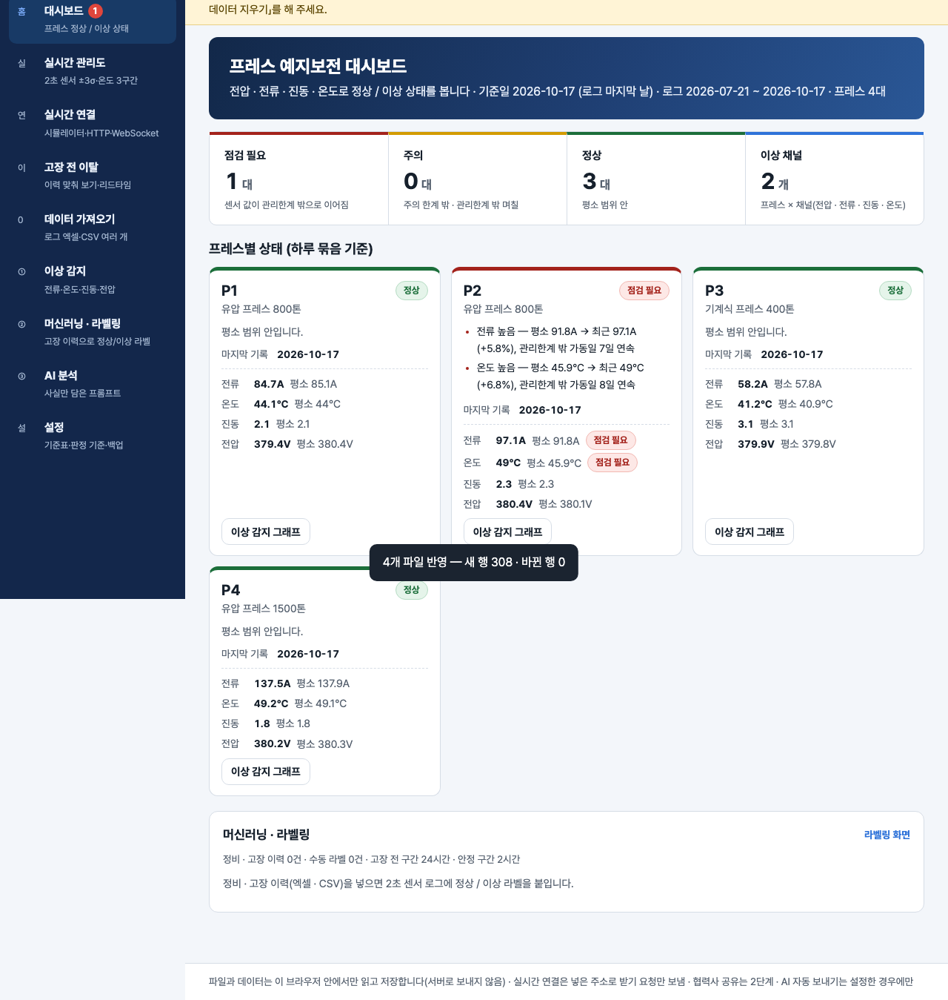

# 프레스 예지보전 — 프로젝트 기획서 v2.1

- 기획: 조병철 · 작성일 2026-11-10 · 현장 데이터 디지털화 전문가과정 · 2차수 프로젝트 01
- 바로 쓰기: https://data10-01.jobability.co.kr/
- 워드 판: `docs/기획서/data10-01_조병철_프레스예지보전_기획서_v2.1.docx`

## 개요

프레스의 전압 · 전류 · 진동 · 온도 2초 센서 값을 ±3σ 관리도 · 온도 3구간으로 실시간 관리해 정상 / 이상 상태를 보고, 정비 · 고장 이력으로 라벨을 붙여 머신러닝 학습용 데이터셋을 만드는 예지보전 도구입니다.

### 배경 · 현재 업무
- 프레스는 설비 트러블이 나면 생산이 멈추고, 금형을 수명보다 오래 쓰면 품질 · 파손 위험이 커집니다.
- 진동 · 전류 · 전압 · 온도 · 타수 데이터는 있지만, 이상 징후를 미리 알리거나 금형 교체 · 오버홀 시기를 챙기는 체계가 없습니다.
- 협력사 MES 구축 지원 업무라 협력사가 외부 망에서 웹 페이지로 접속해 쓸 수 있어야 합니다.
- 센서는 2초마다 값을 보내고 타수는 10초에 1타씩 오릅니다. 값마다 ±3σ 관리선으로 관리하려 합니다.

### 목표
- 로그 엑셀 · CSV 와 2초 센서 로그를 그대로 넣어 관리도와 상태를 바로 봅니다.
- 전류 · 전압 · 진동은 ±3σ, 온도는 예열 · 안정 생산 · 위험 3구간으로 관리합니다.
- 고장 이력과 경보를 맞춰 고장 전에 얼마나 미리 알 수 있었는지(리드타임)를 잽니다.
- 정비 · 고장 이력으로 센서 값에 정상 / 이상 라벨을 붙여 학습용 데이터셋을 만듭니다(v2.1).
- 설비에서 실시간으로 값을 받는 화면을 두고, 설비 연결은 2단계에서 붙입니다.

## 요구사항과 구현

| 기획서 요구 | 구현 |
|---|---|
| 프레스 이상 감지 알림 | 최근 14일을 직전 42일 기준선(중앙값 · MAD)과 비교, 주의 · 점검 필요와 근거 숫자 |
| 2초 센서 값 ±3σ 관리선(2차) | 실시간 관리도 4장 — 중심선 · ±3σ · ±2σ · 이탈점, 기준 구간 기본 = 전체 구간(3차) |
| 온도 3구간 관리선(3차) | 예열 · 안정 생산 · 위험 띠, 구간별 시간 · 예열 시간 · 위험 경보, 경계는 프레스마다 고침 |
| 실시간 — 설비에서 바로 받기(3차) | 시뮬레이터 · HTTP 주기 받기 · WebSocket 과 중계 견본(tools/relay.mjs). PLC → 게이트웨이 연결은 2단계 |
| 가상 고장 데이터로 확인(3차) | 3대 × 5일 2초 로그 + 고장 · 정비 · 금형 교체 이력, 「고장 전 이탈」 리드타임 |
| 머신러닝 탭 — 정상 · 이상(고장 이력) 라벨링(v2.1) | 정비 · 고장 이력(maintenance_log) 가져오기 · 직접 넣기 · 고치기, 규칙 라벨(고장 전 24시간 ~ 조치 = 이상, 조치 뒤 2시간 = 제외) + 수동 라벨, 라벨 분포 · 특징 요약 · z 점수 기준선 모델 혼동행렬, 학습용 CSV |
| 금형 타수 · 교체주기 · 오버홀 알림 · 월별 타수 보고서 삭제(v2.1) | 왼쪽 탭 3개와 대시보드 카드 · 상태 근거에서 뺌. 저장된 기준표 값은 지우지 않음(읽기만 안 함) |
| 외부 망 · 협력사 접속 | 웹 주소 + 로그인 · 사용 신청 · 관리자 승인. 업무 데이터 함께 보기는 2단계 |
| 알림 보내기(메일 · 메신저) | 2단계 — 지금은 화면 표시 |

## 주요 기능

- **실시간 관리도** — 2초 센서 값의 전류 · 전압 · 진동을 ±3σ 관리선으로, 온도는 예열 · 안정 · 위험 3구간으로 그립니다.
- **고장 전 이탈** — 고장 · 정비 이력과 경보를 맞춰 고장 몇 시간 전에 경보가 울렸는지 리드타임을 잽니다.
- **머신러닝 · 라벨링** — 정비 · 고장 이력으로 2초 센서 값에 정상 · 이상 · 제외 라벨을 붙이고, 구간을 골라 고치고, 학습용 CSV 로 내려받습니다.
- **실시간 연결** — 시뮬레이터 · HTTP 주소 · WebSocket 으로 값을 받아 관리도를 다시 그리고 경보를 바로 띄웁니다.
- **데이터 가져오기** — 엑셀 · CSV 여러 개, 열 연결, 큰 2초 로그는 4MB 조각으로 나눠 읽습니다.
- **이상 감지 · 대시보드** — 전압 · 전류 · 진동 · 온도의 평소 대비 최근 값으로 프레스마다 정상 · 주의 · 점검 필요를 보입니다.
- **AI 분석** — 계산된 사실만 담은 프롬프트, 프레스 이름은 별칭으로 가립니다.
- **로그인 · 사용 승인** — 회사 메일이나 개인 메일로 가입하고 사용 신청 → 관리자 승인 뒤 씁니다.

## 처리 흐름(파이프라인)

1. **로그인 · 승인** — 가입 · 사용 신청 뒤 관리자가 승인하면 도구가 열림
2. **로그 넣기** — 일일 로그 엑셀 · CSV, 2초 센서 로그, 또는 실시간 연결
3. **정리 · 타수 계산** — 열 연결, 중복 제거, 누적 차이로 타수, 정지 · 끊김 표시
4. **관리선 판정** — ±3σ 관리도와 온도 3구간, 10분 안에 5번 이탈하면 경보
5. **이력 맞춰 보기** — 고장 · 정비 이력과 경보를 견줘 리드타임 · 헛경보 후보
6. **라벨링** — 정비 · 고장 이력으로 정상 · 이상 · 제외 라벨, 사람이 구간을 골라 고침
7. **학습용 데이터셋** — 라벨 분포 · 특징 요약 · 기준선 모델, 학습용 CSV · 관리도 · 리드타임 엑셀

## 구성(아키텍처)

- **화면 (index.html · js/app.js)** — 대시보드 · 실시간 관리도 · 실시간 연결 · 고장 전 이탈 · 데이터 가져오기 · 이상 감지 · 머신러닝 · 라벨링 · AI 분석 · 설정
- **계산 (js/logic.js · spc.js · pdm.js · live.js · label.js)** — 타수 · 하루 묶음 · 기준선 · 이상 감지 · ±3σ 관리 한계 · 규칙 · 온도 3구간 · 경보 · 리드타임 · 라벨 · 기준선 모델(label.js) · 받은 값 모으기 · charts.js 그래프
- **저장** — localStorage 기준표 · 일일 기록 · 정비 · 고장 이력 · 수동 라벨 · IndexedDB 2초 로그 · JSON 백업 · 되살리기
- **로그인 · 승인** — js/auth.js · Supabase data1001_members · 사용 신청 · 관리자 승인
- **라이브러리 (vendor/)** — SheetJS — 엑셀 · supabase.js — 로그인
- **검증 (test/ · tools/)** — logic.test.mjs 67 · label.test.mjs 19 · relay.test.mjs 8 · tools/relay.mjs 중계 견본
- **배포** — data10-01.jobability.co.kr · 내 깃허브 Pages · 내 Supabase

## 화면 구성(와이어프레임)

## 규칙 · 판정 기준

- 관리선 기준 구간 기본값은 데이터가 있는 전체 구간(정지 구간 제외)입니다. 처음 N개 · 기간 지정으로 바꿀 수 있습니다.
- σ 기본값은 표본 표준편차입니다. 2초 값은 앞뒤 상관이 커서 이동범위(MR̄/1.128) 방식은 관리선이 지나치게 좁아집니다.
- 경보 = 10분 안에 ±3σ 밖 5번. 예열 구간 이탈은 기본으로 뺍니다.
- 온도 위험 경보는 위험 구간에 30초 넘게 머물 때만 냅니다.
- 리드타임은 경보 조건이 찬 시각부터 고장 시각까지, 고장 앞 24시간(앞선 고장 · 정비 뒤부터) 안에서 셉니다.
- 이상 감지는 최근 14일을 직전 42일 기준선(중앙값 · MAD)과 비교해 ±3σ 를 가동일 3일 연속 넘으면 점검 필요입니다.
- 실시간 관리선은 받기 시작할 때 고정합니다(가져온 2초 로그, 없으면 처음 10분).
- 기준일은 오늘이 아니라 로그 마지막 날입니다.
- 라벨 — 설비가 같고 [발견 일시 − 고장 전 구간(기본 24시간), 조치 일시] 안이면 이상, 조치 뒤 안정 구간(기본 2시간)은 제외, 나머지 정상. 겹치면 이상이 제외보다, 수동 라벨이 규칙보다 앞섭니다.
- 기준선 모델은 1분 평균 칸으로 설비마다 정상 칸 절반(번갈아)에서 평균 · 표준편차를 잡고, 채널 z 점수 최댓값이 3 을 넘으면 이상으로 판정합니다(맛보기).

## 검증

- 계산 규칙 테스트 67개 통과
- 라벨링 시험 test/label.test.mjs 19개 통과(이력 읽기 · 경계 · 겹침 · 수동 우선 · 특징 요약 · CSV · z 모델 · 가상 이력). 경계 · 판정을 일부러 깨뜨려 5개가 실패하는 것을 확인했습니다.
- 중계 서버 시험 test/relay.test.mjs 8개 통과(HTTP · since · CSV · CORS · WebSocket · CSV 재생).
- 3차에서 규칙 16가지를 일부러 깨뜨려 모두 시험이 실패하는 것을 확인했습니다(경보 「5번 이상」→「넘게」 등).
- 브라우저 점검 scripts/check-browser.mjs 120개(v2.1) — 메뉴 정리 · 라벨링(수동 라벨 · 이력 넣기/고치기/빼기 · 학습용 CSV) · 폭별 가로 넘침 · JS 오류 0.

## 이번 판에서 하지 않는 것

- 업무 자료는 아직 팀 공유 DB 가 아니라 각자의 브라우저(localStorage · IndexedDB)에 저장합니다. 협력사끼리 같은 데이터를 함께 보지 못합니다.
- 설비(PLC) → 게이트웨이 → 중계 연결은 만들지 않았습니다. 페이지는 HTTP · WebSocket 으로 받는 쪽까지입니다.
- 온도 경계 · 경보 기준은 가상 데이터로 잡은 기본값입니다. 실제 설비 기준으로 고쳐야 합니다.
- 경보를 메일 · 메신저로 보내지 않습니다(화면 표시).
- 학습은 z 점수 기준선 모델 맛보기까지입니다. 본격 모델(로지스틱 회귀 · 트리 등)은 내려받은 학습용 CSV 로 만듭니다. 화면의 정확도는 지금 들어 있는 자료로 계산한 값이며 가상 데이터에서는 실제 성능이 아닙니다.

## 다음 단계

- 팀 공유 저장 — 로그 · 이력 · 라벨을 Supabase 에 두고 승인된 팀원이 함께 보기
- 설비 연결 — PLC 주소표 · 회사 망 정책을 받아 게이트웨이 · 중계 구성
- 실제 정비 · 고장 이력으로 라벨을 붙이고 경보 기준 · 고장 전 구간 다시 재기
- 학습 모델(로지스틱 회귀 · 트리) 결과를 실시간 관리도의 정상 / 이상 예측으로 연결, 알림 보내기

## 버전 이력

- **v2.1** (2026-11-10) — 금형 타수 · 교체주기 · 오버홀 알림 · 월별 타수 보고서 탭과 대시보드 카드 삭제(저장 자료는 보존) / 머신러닝 · 라벨링 탭 — 정비 · 고장 이력(maintenance_log) 가져오기 · 직접 넣기 · 고치기 / 규칙 라벨(고장 전 24시간 ~ 조치 = 이상 · 조치 뒤 2시간 = 제외) + 수동 라벨, 시계열 띠 그림 / 라벨 분포 · 특징 요약 · z 점수 기준선 모델 혼동행렬 · 학습용 CSV / 가상 정비 · 고장 이력 3건(가상 고장 데이터와 같은 사건)
- **v2.0** (2026-11-10) — 최종 기획서 — 파이프라인 · 아키텍처 · 와이어프레임 정리 / 로그인 · 사용 신청 · 관리자 승인(요청자 Supabase 로 옮길 수 있게) / 로그인 전 대문
- **v1.3** (2026-11-08) — 사이트 주소를 새 과정 도메인으로 옮김
- **v1.2** (2026-10-27) — 3차 — 관리선 기준 구간 기본 = 전체 구간 / 가상 고장 데이터 + 고장 전 이탈 리드타임 / 실시간 연결(시뮬레이터 · HTTP · WebSocket) + 중계 견본 / 온도 3구간 관리선 / 판 질의 ?v= · fresh-guard
- **v1.1** (2026-10-21) — 2차 — 2초 센서 로그 가져오기(나눠 읽기 · IndexedDB) / ±3σ 실시간 관리도 · 이탈 목록 엑셀 / 타수 · 가동률 · 정지 · 금형 리셋
- **v1.0** (2026-10-20) — 1단계 — 로그 가져오기 · 대시보드 · 금형 타수 · 오버홀 알림 · 이상 감지 · 월별 보고서 · AI 프롬프트
